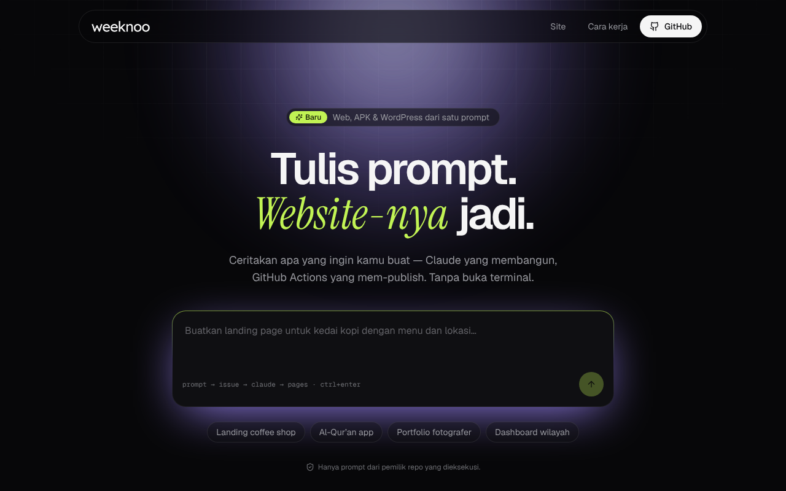
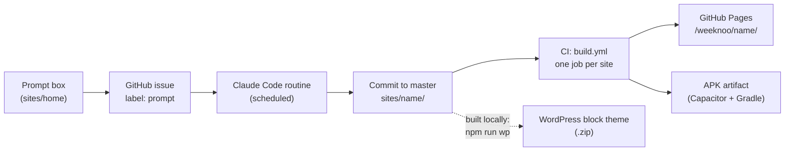

# weeknoo

**A website workspace that turns a written prompt into a static site, an Android APK and a WordPress block theme — all from one React codebase per site.**

[](https://github.com/chalidade/weeknoo/actions/workflows/build.yml)
[](https://chalidade.github.io/weeknoo/)


> **Dokumentasi Bahasa Indonesia:** [PANDUAN.md](PANDUAN.md) (full manual) · [INSTALL.md](INSTALL.md) (setup) · [WORDPRESS.md](WORDPRESS.md) (WordPress theme) · [DEPLOY.md](DEPLOY.md) (publishing and APK signing)

[](https://chalidade.github.io/weeknoo/)

## What it does

1. **Prompt.** The homepage ([`sites/home`](sites/home)) has a single prompt box. Submitting it opens a prefilled GitHub issue labeled `prompt` on this repository.
2. **Site.** A scheduled Claude Code routine picks the issue up, scaffolds and builds the requested site under the rules in [CLAUDE.md](CLAUDE.md), commits it, comments on the issue and closes it.
3. **Publish.** On every push, GitHub Actions builds every site, publishes them to GitHub Pages under `/weeknoo/<site>/`, and packages each one as a debug **Android APK** (downloadable from the workflow run).
4. **WordPress.** Any site can also be converted locally into an installable **WordPress block theme**: each section becomes a block pattern, the navbar and footer become template parts, and `theme.json` is generated from the site's design tokens.

The pipeline only acts on issues opened by the repository owner; [`guard-issues.yml`](.github/workflows/guard-issues.yml) automatically closes and locks issues opened by anyone else.

## Architecture



There is no server. GitHub issues are the queue, the routine is the worker, and GitHub Actions is the build farm.

Each site under `sites/<name>/` is a fully independent Vite app with its own `package.json` and lockfile, generated from [`template/`](template). Every site ships with the same stack and bundled libraries:

| Layer | What every site gets |
| --- | --- |
| Framework | Vite, React 19, TypeScript, Tailwind CSS v4 (`@tailwindcss/vite`, tokens in `src/index.css`) |
| UI | shadcn/ui pre-wired (`components.json`, `@/*` alias, `cn()`), plus the [21st.dev](https://21st.dev) registry as an `@21st` namespace; Motion for animation; lucide-react icons; Recharts; a CKEditor 5 wrapper |
| Data APIs — `src/lib/api` | Typed clients for the Quran (equran.id, with tafsir), hadith collections, and Indonesian administrative regions (province → village); the asbabun nuzul dataset is bundled and lazy-loaded |
| Local database — `src/lib/db` | A per-site Dexie (IndexedDB) database with JSON export/import for backups and moving data between devices |
| Local AI — `src/lib/ai` | Chat and streaming against a model running in [Ollama](https://ollama.com) on the user's own machine: no API keys, no hosted provider. The model's reasoning is returned separately from the answer, including when `<think>` tags are split across stream chunks |

## Repository layout

| Path | Purpose |
| --- | --- |
| [`template/`](template) | The starter every site is generated from (stack, config, bundled `src/lib/` libraries) |
| [`categories/`](categories) | Full-page overlays applied on top of the template — currently blog, company-profile, education, landing-product, local-business, photography, portfolio, restaurant, saas. [`categories/SPEC.md`](categories/SPEC.md) is the contract each one must satisfy |
| [`sites/`](sites) | Every generated website, one independent app per folder |
| [`scripts/`](scripts) | Generator, component installer, APK build, WordPress build, site deletion, category check, issue guard |
| [`scripts/wp/`](scripts/wp) | The React → WordPress block theme converter (`gen-entry.mjs`, `build-theme.mjs`, `lib/`) |
| [`.github/workflows/`](.github/workflows) | `build.yml` (build all sites + APKs, deploy to Pages) and `guard-issues.yml` (close and lock non-owner issues) |
| [`CLAUDE.md`](CLAUDE.md) | The contract Claude Code follows when building or editing a site |

## Quick start

Requirements: Node.js 22 (the CI version), Git, and Bash. The APK build additionally needs the Android SDK and a JDK (CI uses Temurin 21); the WordPress build uses Chrome for the optional theme screenshot. [INSTALL.md](INSTALL.md) covers setup in detail, including what a fork needs to change.

```bash
git clone https://github.com/chalidade/weeknoo.git
cd weeknoo

npm run categories                          # list available category templates
npm run new -- my-site                      # blank starter → sites/my-site/
npm run new -- my-site --category saas      # full page from a category template
npm run sites                               # list existing sites

cd sites/my-site
npm run dev                                 # Vite dev server
npm run build                               # tsc -b && vite build
npm run lint                                # oxlint
```

Workspace scripts (run from the repository root):

| Command | What it does |
| --- | --- |
| `npm run new -- <site> [--category <name>] [--no-install]` | Scaffold `sites/<site>/` from `template/` (plus an optional category overlay) and install dependencies |
| `npm run categories` | List the category overlays |
| `npm run add -- <site> <component...>` | Install shadcn/ui components or `@21st/<author>/<slug>` (21st.dev links are normalised; needs a key in `.env`, see `.env.example`) |
| `npm run apk -- <site> [--release]` | Build the site and wrap it into an Android APK with Capacitor → `sites/<site>/<site>-debug.apk` |
| `npm run wp -- <site> [--no-screenshot] [--keep-build]` | Build a WordPress block theme → `sites/<site>/<site>-wp-theme.zip` |
| `npm run delete -- <site> [--yes]` | Remove a site and its card on the homepage (refuses to delete `home`) |
| `npm run check-categories [-- <name>...]` | Type-check and build every category overlay against a throwaway site |
| `npm run guard -- on\|off\|status` | Toggle GitHub's temporary collaborators-only interaction limit for the repo |
| `npm run sites` | List the sites in `sites/` |

Android runtime permissions are declared per site in `sites/<site>/android-permissions.txt` (one `android.permission.*` per line); `build-apk.sh` injects them into the generated manifest on every build, so the regenerable `android/` folder is never hand-edited.

## Sites

| Site | Description | Live |
| --- | --- | --- |
| [`home`](sites/home) | The workspace landing page and prompt box | [chalidade.github.io/weeknoo](https://chalidade.github.io/weeknoo/) |
| [`ask`](sites/ask) | Chat with a local AI model through Ollama, with its reasoning shown separately (needs Ollama on the visitor's machine) | [/weeknoo/ask/](https://chalidade.github.io/weeknoo/ask/) |
| [`jaim`](sites/jaim) | Daily prayer log, Quran reading progress and location-based prayer times | [/weeknoo/jaim/](https://chalidade.github.io/weeknoo/jaim/) |
| [`hachili-coffee`](sites/hachili-coffee) | Cafe website with menu, recommended bundles and WhatsApp reservations | [/weeknoo/hachili-coffee/](https://chalidade.github.io/weeknoo/hachili-coffee/) |
| [`bubur-bara`](sites/bubur-bara) | Breakfast ordering app: cart, next-day scheduled orders, QRIS payment proof upload, order history | [/weeknoo/bubur-bara/](https://chalidade.github.io/weeknoo/bubur-bara/) |

Site content is in Indonesian.

## Key design decisions

- **A serverless pipeline built on GitHub issues.** The homepage only produces a prefilled issue URL; GitHub handles authentication, the issue tracker is the job queue, and the build and deploy run in GitHub Actions. Nothing has to be hosted or kept running.
- **A flat repo instead of a monorepo.** There are no npm workspaces and no shared `node_modules`. Each site installs its own dependencies, so one site can upgrade, break or be deleted without affecting another, and CI builds each one in its own matrix job.
- **One file per section.** `App.tsx` only composes; every section is a self-contained component in `src/components/` that reads nothing from its siblings. A single section can be regenerated without regressions elsewhere, and the section boundaries carry through into the WordPress theme as individual block patterns.
- **Design tokens as the single source of truth.** Colors, radius and fonts live as CSS variables on `:root` in `src/index.css`. The WordPress build reads those same tokens to generate the `theme.json` palette and font families, so the site and the theme cannot drift apart.
- **Cascade-layer unwrapping for WordPress.** Tailwind v4 emits everything inside `@layer`, while WordPress core block CSS is unlayered, and unlayered rules always win. `build-theme.mjs` unwraps Tailwind's layers so both stylesheets compete on normal specificity instead of core styles silently overriding the design system.
- **Elements that would not round-trip are kept as HTML.** Headings, paragraphs and containers become editable core blocks. Anything whose markup would not survive a core block's `save()` (icons, images) stays a `core/html` block, which avoids WordPress's "unexpected or invalid content" warnings.
- **Local LLMs through Ollama.** AI features call a model on the user's own device, so there are no API keys, no usage costs and no conversation data leaving the machine. The trade-off, which is documented, is that AI only works where Ollama is installed.

## Quality gates

There is no test runner in this repository, and no tests are claimed. The gates are:

- **`npm run build`** in each site (`tsc -b && vite build`): a full TypeScript type-check before bundling. CI runs it for every site on every push (through the APK build), and the APK and WordPress scripts run it first.
- **`npm run check-categories`**: builds every category overlay against a fresh copy of the template to catch breakage before a site is generated from it.
- **`npm run lint`** (oxlint) is available in each site.

## How this was built

weeknoo was built with [Claude Code](https://claude.com/claude-code). I designed the pipeline and made the architecture decisions (issue-driven builds, the flat per-site layout, the section-per-file contract, the token-driven WordPress conversion, local-only AI). I also reviewed the generated code and tested the builds, including APKs on real Android devices. [CLAUDE.md](CLAUDE.md) is the contract the agent works under, both locally and in the scheduled routine.

## Dokumentasi Bahasa Indonesia

| File | Contents |
| --- | --- |
| [PANDUAN.md](PANDUAN.md) | Full workspace manual: repo map, daily commands, bundled libraries, publishing, APK, pipeline, troubleshooting |
| [INSTALL.md](INSTALL.md) | Setting the workspace up on your own machine, and what to change for another GitHub account |
| [WORDPRESS.md](WORDPRESS.md) | Packaging a site as a WordPress block theme, including a local WordPress test recipe |
| [DEPLOY.md](DEPLOY.md) | Publishing the web build to any static host, and building/signing the APK |

## Author

**Chalid Ade Rahman** — [chalidade.github.io](https://chalidade.github.io)
